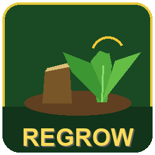

<p align="center">
  <a href="https://github.com/DTM-Mods"></a>
</p>

<p align="center">
  
</p>

<h1 align="center">Banana Regrow</h1>

<p align="center">
  
  <a href="https://github.com/DTM-Mods/FS25_BananaRegrow/releases/latest"></a>
  
  
  <a href="https://github.com/DTM-Mods"></a>
</p>

<p align="center">
  <b>Harvest and cut back a whole banana plantation in one click: the bananas go straight into your washing station, the plants regrow.</b>
</p>

<p align="center">
  <a href="https://github.com/DTM-Mods/FS25_BananaRegrow/releases/latest"></a>
</p>

<p align="center">
  
</p>

The banana plantations of the Beans & Alpacas Pack want one machete swing per plant: harvest each bunch, carry it to
the washing station or hook it on the rail, then cut the plant down so it regrows. With hundreds of plants that is an
evening's work. Banana Regrow does it for a whole area at once:

- **Harvest:** every ripe plant in the area is harvested with your machete, the same way a swing does it, so the game
  decides how many liters each plant gives. The bananas go straight into your farm's nearest washing station. No
  bunches to carry or hook on the rail.
- **Cut back:** harvested, half-cut and withered plants go to the cut-down state the machete leaves, so they regrow
  from the next month. Plants that are still growing are left alone.
- **Your land only:** plants on other farms' land are skipped.
- **Washing station menu fix:** with some other mods the washing station's production menu has more buttons than
  bottom-bar slots, and the DLC's "Manage workers" button disappears. Banana Regrow adds slots so every button shows.

<p align="center">
  
</p>

Carry the machete (in the hand or in the backpack) so ripe plants can be harvested. Without it, the tool only cuts back.

**Construction menu** (Shift + P > Landscaping > Banana Regrow)

1. Left click one corner of the area, then the opposite corner. The area is drawn on the ground. Ripe plants get a
   yellow marker, plants to cut back a green one.
2. Left click again: "Harvest R, cut back N plants". The result shows next to the cursor.
3. Or, with nothing marked, right click a plantation to harvest and cut back all of it.

<p align="center">
  
</p>

| Where | Input | Action |
|---|---|---|
| Construction menu | Left click | First corner, opposite corner, then harvest and cut back the area |
| Construction menu | Right click | Remove the last corner; with nothing marked: the whole plantation under the cursor |
| Construction menu | Esc | Clear the area |
| On foot | Left Alt + K | Mark a corner where you stand |
| On foot | Left Alt + L | Harvest and cut back the marked area (with nothing marked: the plantation next to you) |
| On foot | Left Alt + J | Clear the area |

Messages only appear on your own screen (at the cursor, or on foot under the area line), never in the game's
notification list.

<p align="center">
  
</p>

| Command | What it does |
|---|---|
| `brHarvest [radius\|all]` | Harvest the ripe plants within the radius (default 10 m), or `all` for the plantation next to you, into the washing station |
| `brCollect [radius]` | Put banana bunches lying loose on the ground within the radius (default 30 m) into your washing station. Bunches on a rail are left alone. Admins only on a server |
| `brCutAll` | Switch to cutting back everything that stands in the area, also ripe and growing plants (a full reset) |
| `brInfo` | Write the nearest plantation's technical details to log.txt |
| `brMenu` | Write the washing station menu's buttons and their hooks to log.txt (open that menu first) |
| `brDebug` | Debug logging on/off |
| `brProbe`, `brTrace`, `brRipen` | Research tools used to build the harvest (log the DLC's banana code, make plants ripe). Admins only on a server; they will be removed |

<p align="center">
  
</p>

The server does the work: the client sends the area, the server harvests with that player's machete, fills the washing
station, cuts the plants back and sends the result to that player only. The farm is taken from the player's
connection, not from what the client claims.

<p align="center">
  
</p>

Put `FS25_BananaRegrow.zip` in `Documents/My Games/FarmingSimulator2025/mods`. In multiplayer, install it on the server
and on every player's game. Needs the Beans & Alpacas Pack; without it the mod does nothing.

<p align="center">
  
</p>

- Harvesting is confirmed in single player. On a dedicated server, 1.2.2.0 harvested the plants but the bunches fell
  to the ground; 1.2.3.0 and later find the bunch where the game creates it, which still needs confirming on a live
  server. Bunches left on the ground can be put into the station with `brCollect`.
- With a large area and more than one washing station, each plant's bananas go to the station nearest that plant.

<p align="center">
  
</p>

How it works:

- The plantations are DLC placeables of type `pdlc_beansAndAlpacasPack.orchard`. Their plant nodes are listed in
  `g_currentMission.vineSystem.nodes`, and `placeable:getVineAreaByNode(node)` gives each plant's density area. The
  plants are the base-game `BANANA` fruit type; states are resolved by name, never hard-coded.
- **Cut back:** a `DensityMapModifier` with a state filter over each plant's area, counted with `executeGet` (the
  return value of `executeSet` is not a pixel count), then `placeable:updateVineNode(node, false)` so the model
  switches at once.
- **Harvest:** the machete hand tool's own `executeHarvest(x, y, z, false)` at the bunch (plant + 1.9 m). That creates a
  `BananaBunch` object with `fillLevel` liters. The mod takes it out of the hands (or catches it while it registers
  through `g_currentMission:addNodeObject`), deletes it and adds the liters to the nearest washing station's storage
  (base-game `Storage:setFillLevel`, which syncs to every player).
- **Multiplayer:** `BananaRegrowCutEvent` (client to server, with a harvest flag) and `BananaRegrowResultEvent`
  (server to the requesting client).

Tests run offline on Lua 5.1 through Python [lupa](https://pypi.org/project/lupa/), with stubs for the engine:

```
pip install lupa
python tools/test/run_all.py     # every offline test
python tools/check_l10n.py       # English and German texts complete
python tools/build_zip.py        # dist/FS25_BananaRegrow.zip + GIANTS packaging checks
```

<p align="center">
  
</p>

### 1.2.5.0

- First release on GitHub.
- Harvest and cut back in one click (construction menu, Left Alt + L, `brHarvest`); the bananas go straight into the
  washing station.
- Server-side harvest for multiplayer, `brCollect` for bunches left on the ground.
- Messages only on the own screen.
- Extra bottom-bar slots so the washing station's "Manage workers" button shows next to other mods' buttons.

<p align="center">
  
</p>

MIT, see [LICENSE](LICENSE). The Beans & Alpacas Pack and the base-game content the mod works with belong to GIANTS
Software and are not covered by it.

---

<p align="center">
  <a href="https://github.com/DTM-Mods"></a><br>
  <sub>Part of <a href="https://github.com/DTM-Mods">DTM Mods</a> (Dead To Me) by PropaineX & Fennell</sub>
</p>
