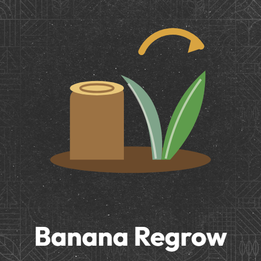

# ModHub upload: Banana Regrow

What to enter in the GIANTS ModHub upload form for this mod. Each text box below has a copy button on GitHub.



**Mod Icon (512x512):** [`icon_512.png`](icon_512.png)

| Field | Value |
|-------|-------|
| Title English | Banana Regrow |
| Title German | Banana Regrow |
| Title French | Banana Regrow |
| Version | `1` `2` `5` `1` |
| Author | DTM Mods, Fennell |
| Manufacturer | Lizard |
| Category 1 | Gameplay |
| Category 2 | Not Set |
| Category 3 | Not Set |

## Title English
```text
Banana Regrow
```

## Title German
```text
Banana Regrow
```

## Title French
```text
Banana Regrow
```

## Description English
```text
Category: Landscaping > Banana Regrow (construction menu)
Price: $0
Monthly upkeep: none
Hotkeys (on foot): Left Alt + K marks a corner, Left Alt + L cuts back, Left Alt + J clears the area. Controller: none by default, set them under Settings > Controls.
Requires: Beans & Alpacas Pack (DLC)

Cut back a whole banana plantation at once so it regrows, instead of swinging the machete at every plant.

Open the construction menu (Shift + P by default), Landscaping > Banana Regrow. Left click one corner of the area and then the opposite corner: the area is drawn on the ground, the plants that need cutting get a green marker, and the cursor shows how many there are. Left click again to cut them all back. Right click takes back the last corner. With nothing marked, a right click on a plantation cuts back the whole plantation.

Ripe plants are harvested first, like with the machete, and their bananas go straight into your farm's nearest washing station (carry the machete; in multiplayer the server does it). Then harvested, half-cut and withered plants go to the cut-down state the machete leaves, so they regrow from the next month. Plants that are still growing are left alone.

The same works on foot with the keys above: mark a corner where you stand, cut back the marked area (or, with nothing marked, the plantation next to you), clear the area.

Only plants on land of your own farm are touched. Works in multiplayer (the server does the cutting). Needs the banana plantations of the Beans & Alpacas Pack; without them the mod does nothing.

The menus' bottom bar gets extra button slots when a page has more buttons than fit, so the washing station's "Manage workers" button no longer disappears when another mod (e.g. Production Storage Control's "Spawn goods") adds a button.

Console: brHarvest [radius|all] harvests the ripe plants around you into the washing station, brCollect [radius] puts banana bunches lying on the ground into it (admins), brCutAll toggles cutting ALL plants in the area (also ripe and growing ones) for a full reset, brInfo writes the plantation's technical details to the log, brDebug toggles debug logging. Research (admins): brProbe and brTrace log how the game harvests with the machete, brRipen [radius] makes your plants around you ripe.
```

## Description German
```text
Kategorie: Landschaftsbau > Banana Regrow (Baumenü)
Preis: 0 €
Monatliche Unterhaltskosten: keine
Tastenkombinationen (zu Fuß): Links Alt + K markiert eine Ecke, Links Alt + L schneidet zurück, Links Alt + J löscht die Fläche. Controller: standardmäßig keine, unter Einstellungen > Steuerung belegen.
Benötigt: Beans & Alpacas Pack (DLC)

Eine ganze Bananenplantage auf einmal zurückschneiden, damit sie nachwächst, statt jede Pflanze einzeln mit der Machete zu bearbeiten.

Das Baumenü öffnen (Standard: Umschalt + P), Landschaftsbau > Banana Regrow. Eine Ecke der Fläche und dann die gegenüberliegende Ecke anklicken: Die Fläche wird am Boden angezeigt, Pflanzen, die zurückgeschnitten werden müssen, bekommen eine grüne Markierung, und der Cursor zeigt ihre Anzahl. Ein weiterer Linksklick schneidet sie alle zurück. Rechtsklick nimmt die letzte Ecke zurück. Ohne Markierung schneidet ein Rechtsklick auf eine Plantage die ganze Plantage zurück.

Reife Pflanzen werden zuerst geerntet, wie mit der Machete, und ihre Bananen kommen direkt in die nächste Waschstation deines Hofs (Machete mitnehmen; im Multiplayer erledigt das der Server). Dann kommen geerntete, halb geschnittene und verdorrte Pflanzen in den Zustand, den die Machete hinterlässt, und wachsen ab dem nächsten Monat nach. Pflanzen im Wachstum bleiben unberührt.

Zu Fuß geht es auch mit den Tasten oben: eine Ecke am eigenen Standort markieren, die markierte Fläche zurückschneiden (ohne Markierung die Plantage neben dir), die Fläche löschen.

Nur Pflanzen auf Land des eigenen Hofs werden bearbeitet. Funktioniert im Multiplayer (der Server schneidet). Benötigt die Bananenplantagen des Beans & Alpacas Packs; ohne sie tut der Mod nichts.

Die untere Tastenleiste der Menüs bekommt zusätzliche Plätze, wenn eine Seite mehr Tasten hat als hineinpassen. So verschwindet die Taste "Arbeiter verwalten" der Waschstation nicht mehr, wenn ein anderer Mod (z. B. "Waren spawnen" von Production Storage Control) eine Taste hinzufügt.

Konsole: brHarvest [Radius|all] erntet die reifen Pflanzen um dich herum in die Waschstation, brCollect [Radius] bringt herumliegende Bananenbüschel hinein (Admins), brCutAll schaltet das Schneiden ALLER Pflanzen in der Fläche um (auch reife und wachsende) für einen kompletten Neustart, brInfo schreibt die technischen Daten der Plantage ins Log, brDebug schaltet Debug-Ausgaben um. Forschung (Admins): brProbe und brTrace protokollieren, wie das Spiel mit der Machete erntet, brRipen [Radius] macht die eigenen Pflanzen um dich herum reif.
```

## Description French
```text
Catégorie : Aménagement paysager > Banana Regrow (menu de construction)
Prix : 0 €
Entretien mensuel : aucun
Raccourcis (à pied) : Alt gauche + K marque un coin, Alt gauche + L recèpe, Alt gauche + J efface la zone. Manette : aucun par défaut, à attribuer dans Paramètres > Commandes.
Nécessite : Beans & Alpacas Pack (DLC)

Recépez toute une bananeraie d'un coup pour qu'elle repousse, au lieu de donner un coup de machette à chaque plant.

Ouvrez le menu de construction (Maj + P par défaut), Aménagement paysager > Banana Regrow. Clic gauche sur un coin de la zone, puis sur le coin opposé : la zone est tracée au sol, les plants à recéper reçoivent un marqueur vert, et le curseur indique leur nombre. Un nouveau clic gauche les recèpe tous. Le clic droit annule le dernier coin. Sans zone marquée, un clic droit sur une bananeraie la recèpe entièrement.

Les plants mûrs sont d'abord récoltés, comme avec la machette, et leurs bananes vont directement dans la station de lavage la plus proche de votre ferme (prenez la machette ; en multijoueur, c'est le serveur qui s'en charge). Ensuite, les plants récoltés, à moitié coupés et fanés passent à l'état recépé que laisse la machette, et repoussent dès le mois suivant. Les plants encore en croissance ne sont pas touchés.

Cela fonctionne aussi à pied avec les touches ci-dessus : marquer un coin à l'endroit où vous vous trouvez, recéper la zone marquée (ou, sans zone marquée, la bananeraie à côté de vous), effacer la zone.

Seuls les plants sur les terres de votre ferme sont concernés. Fonctionne en multijoueur (le serveur fait le recépage). Nécessite les bananeraies du Beans & Alpacas Pack ; sans elles, le mod ne fait rien.

La barre de boutons en bas des menus reçoit des emplacements supplémentaires quand une page a plus de boutons qu'il n'en tient, ainsi le bouton « Gérer les ouvriers » de la station de lavage ne disparaît plus quand un autre mod (p. ex. « Faire apparaître des marchandises » de Production Storage Control) ajoute un bouton.

Console : brHarvest [rayon|all] récolte les plants mûrs autour de vous dans la station de lavage, brCollect [rayon] y met les régimes de bananes qui traînent au sol (admins), brCutAll active ou désactive le recépage de TOUS les plants de la zone (y compris mûrs et en croissance) pour une remise à zéro complète, brInfo écrit dans le log les détails techniques de la bananeraie, brDebug active ou désactive le log de débogage. Recherche (admins) : brProbe et brTrace enregistrent comment le jeu récolte avec la machette, brRipen [rayon] fait mûrir vos plants autour de vous.
```

## Before uploading

- Screenshots for the upload: [`modhub/screenshots/`](screenshots) (1600x900, unedited in-game shots, `1.jpg` first).
- The icon was upscaled from 256 px; a sharper 512 px original would look better on ModHub.
- The mod has no French at all: the in-game texts exist in English and German only, and modDesc.xml has only English and German descriptions. The French text here does not add translations to the mod.
- It ships research and debug console commands for admins (`brProbe`, `brTrace`, `brRipen`, which makes plants ripe, and `brDebug`; `scripts/BananaRegrowProbe.lua`). Your decision whether they stay in a ModHub build.
- Harvesting is confirmed in single player but not yet on a dedicated server.
